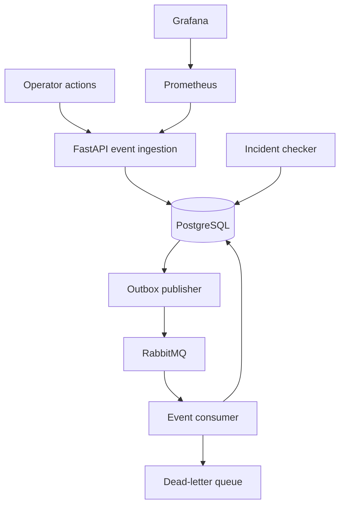

# Event Incident Platform

An event-driven Python backend that monitors device heartbeats and manages incidents from detection through recovery.

Built with **FastAPI, PostgreSQL, RabbitMQ, Docker, Prometheus, and Grafana**. The project explores reliable event delivery, duplicate handling, failure recovery, and auditable state changes.

## Architecture



1. The API commits each new event and its pending outbox entry in one PostgreSQL transaction.
2. The publisher sends pending events to RabbitMQ and records publication after broker confirmation.
3. The consumer commits event deduplication and heartbeat updates together, then acknowledges the delivery.
4. The incident checker opens incidents for overdue devices and resolves them after a fresh recovery heartbeat.
5. Operator actions and automatic resolution produce audit records. Prometheus and Grafana expose the current open-incident count.

## Engineering Decisions

| Concern | Implementation |
| --- | --- |
| Database–broker consistency | A transactional outbox preserves publication intent alongside the event |
| Duplicate API requests | Event UUIDs identify retries. Identical data returns the saved event, while conflicting data returns `409` |
| Duplicate message delivery | A unique processed-event record prevents repeated database processing |
| Consumer acknowledgment | RabbitMQ acknowledgment follows a successful database commit |
| Out-of-order heartbeats | Conditional updates prevent older timestamps from replacing newer heartbeats |
| Temporary database failures | Connection timeouts receive up to three attempts |
| Invalid or exhausted messages | Confirmed forwarding to a durable dead-letter queue precedes acknowledgment |
| Duplicate active incidents | A partial unique index enforces one unresolved incident per device |
| Audit consistency | Incident state changes and their audit entries share a transaction |

A publisher crash after RabbitMQ confirmation and before the publication timestamp is committed can produce another delivery. Consumer deduplication handles this delivery window through the event UUID.

## Demonstrated Workflows

### Device outage and recovery

A heartbeat older than the configured interval causes the checker to open an incident. Repeated checks preserve one active incident. A fresh heartbeat received after the incident opened allows automatic resolution and records `system` as the audit actor.

### Database outage during consumption

With PostgreSQL stopped, the consumer retries connection timeouts three times. After exhaustion, it forwards the event to `device.events.dlq`. Restoring PostgreSQL enables subsequent processing.

Additional manual checks verified:

- Identical ingestion retries, conflicting UUID reuse, and missing devices.
- Redelivery after a consumer failure before commit.
- Duplicate consumption and out-of-order heartbeats.
- Invalid JSON and invalid event payload forwarding.
- Operator acknowledgment and resolution, including repeated-action conflicts.
- Agreement between the API metric, Prometheus, and an imported Grafana dashboard.

## API

| Method | Endpoint | Purpose |
| --- | --- | --- |
| GET | `/health` | API health |
| POST | `/devices` | Register a device |
| GET | `/devices/{device_id}` | Retrieve a device |
| POST | `/events` | Ingest heartbeat and fault events |
| POST | `/incidents/{incident_id}/acknowledge` | Acknowledge an incident |
| POST | `/incidents/{incident_id}/resolve` | Resolve an incident manually |
| GET | `/metrics` | Export the open-incident gauge |

Interactive documentation is available at `/docs` while the API is running.

## Run Locally

Development environment uses Windows CMD, Python 3.14.3, PostgreSQL 16, and Docker Desktop with Linux containers. Install `psql` and make it available on PATH.

```cmd
git clone https://github.com/Sambala98/event-incident-platform.git
cd event-incident-platform
python -m venv .venv
.venv\Scripts\activate.bat
python -m pip install -r requirements.txt
```

Create a project-root `.env` file with a local database password.

```dotenv
POSTGRES_PASSWORD=replace_with_your_local_password
```

For an existing PostgreSQL volume, use its existing password. Keep `.env` excluded from Git.

Start PostgreSQL.

```cmd
docker compose up -d postgres
docker compose exec postgres pg_isready -U incident_app -d incident_db
```

Initialize an empty database by applying the migrations in order.

```cmd
psql -h 127.0.0.1 -p 5546 -U incident_app -d incident_db -v ON_ERROR_STOP=1 --single-transaction -f migrations\001_create_devices.sql -f migrations\002_create_device_events.sql -f migrations\003_create_event_outbox.sql -f migrations\004_create_processed_device_events.sql -f migrations\005_add_device_last_heartbeat_at.sql -f migrations\006_create_incidents.sql -f migrations\007_add_incident_acknowledgement.sql -f migrations\008_create_incident_audit_log.sql
```

Create RabbitMQ on the first run.

```cmd
docker run -d --name incident-rabbitmq -p 127.0.0.1:5672:5672 rabbitmq:4
docker exec incident-rabbitmq rabbitmq-diagnostics -q check_port_listener 5672
```

For an existing stopped RabbitMQ container, use `docker start incident-rabbitmq`.

Start the API and leave it running.

```cmd
python -m uvicorn main:app --reload --host 127.0.0.1 --port 8001 --env-file .env
```

In another CMD window, enter the project directory and activate `.venv`. Run the processing stages as needed.

```cmd
python outbox_publisher.py
python event_consumer.py
python incident_checker.py
```

Each publisher invocation handles one pending event. Each consumer invocation handles one message. The checker evaluates devices across the database.

## Observability

`GET /metrics` exposes `incidents_open`, a gauge backed by the unresolved incident count.

- `prometheus.yml` configures scraping every 15 seconds.
- `grafana-dashboard.json` contains the exported Open incidents Stat panel.
- Grafana uses an Instant query for `incidents_open{job="event-incident-platform"}`.

Verify the API metric with:

```cmd
curl.exe -fsS --max-time 10 http://127.0.0.1:8001/metrics
```

## Tests

```cmd
python -m pytest -q
```

The latest recorded run passed **12 tests**, primarily covering health and request validation. Delivery failures, retries, incident transitions, and monitoring were verified through manual integration scenarios.

## Current Scope

- Workers run through individual commands. Continuous execution and scheduling remain future work.
- Fault events are ingested and recorded as processed. Incident detection currently uses missed heartbeats.
- Operator identity comes from the request's `actor` field. Authentication and authorization remain future work.
- DLQ investigation and replay require operator intervention. A crash during forwarding can produce duplicate DLQ entries.
- Multiple-worker concurrency and broader automated integration coverage require further testing.
- Monitoring currently covers the open-incident count.